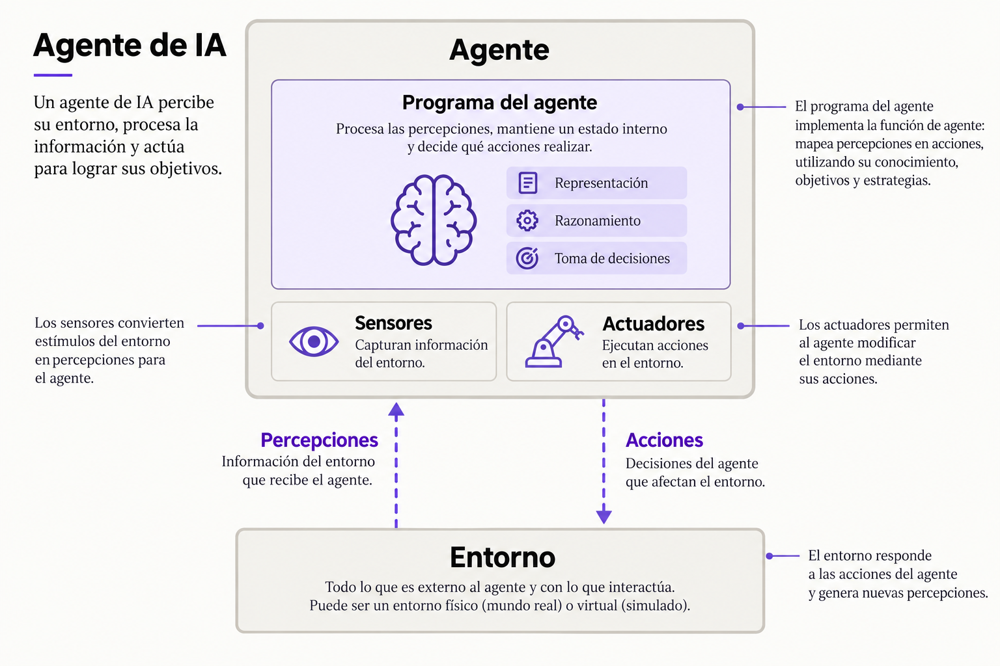

# Capítulo 1. Introducción

Los agentes de programación ya son habituales, pero todavía estamos descubriendo qué pueden hacer. También se usan en finanzas, salud, marketing e investigación científica.

Este capítulo presenta los conceptos básicos y responde una pregunta: «¿Qué es un agente de IA?». En los próximos capítulos conocerás sus componentes y cómo se relacionan.

# ¿Qué es un agente de IA?

Los agentes de IA están en constante evolución, y su definición cambia a medida que aparecen nuevas capacidades y formas de interactuar con el entorno. Aun así, podemos tomar la siguiente definición como punto de partida:

> Un agente es cualquier entidad que pueda considerarse capaz de percibir su entorno mediante sensores y actuar sobre ese entorno mediante actuadores.
> 
> Stuart Russell y Peter Norvig, [_Artificial Intelligence: A Modern Approach_, 4.ª edición, capítulo 2, sección 2.1, p. 32](https://aima.cs.berkeley.edu/4th-ed/pdfs/newchap02.pdf#page=1). Traducción al español.

Podemos descomponer esta definición en los siguientes componentes, que constituyen el núcleo de los agentes:

**Entorno**

El mundo con el que interactúa el agente.

**Sensores**

Los componentes del agente que utiliza para observar el entorno.

**Actuadores**

Las herramientas que usa el agente para interactuar con el entorno.

**Programa del agente**

El «cerebro» o las reglas que usa el agente para decidir cómo pasar de las observaciones a las acciones.

## Modelo de lenguaje

El modelo de lenguaje, o LLM, interpreta las instrucciones y genera las respuestas del agente. También puede proponer qué herramienta usar y con qué información. Es una pieza central, pero necesita otros componentes para consultar datos, conservar contexto y ejecutar acciones.

## Razonamiento

Algunas tareas requieren analizar un problema antes de actuar. El razonamiento permite descomponerlo, comparar alternativas y revisar pasos intermedios. Esta capacidad ayuda al agente a resolver situaciones en las que una respuesta inmediata podría ser insuficiente.

## Memoria

Para continuar una tarea, el agente necesita conservar información relevante: qué pidió el usuario, qué acciones realizó y qué resultados obtuvo. La memoria le permite recuperar ese contexto. Su utilidad depende de seleccionar qué vale la pena recordar y cuándo recuperarlo.

## Herramientas

Las herramientas conectan al agente con su entorno. Le permiten buscar información, consultar una base de datos, ejecutar código o modificar un archivo. El modelo propone una acción y la herramienta la ejecuta; luego, el agente recibe el resultado y decide cómo continuar.

## Planificación

La planificación organiza una tarea en pasos orientados a un objetivo. El agente identifica qué necesita hacer, en qué orden y qué información le falta. A medida que obtiene resultados, puede ajustar el plan, repetir un paso o cambiar de estrategia.

## Reflexión

Después de actuar, el agente puede revisar si el resultado cumple con lo solicitado. La reflexión permite detectar errores y decidir qué corregir. Para que esa revisión sea útil, necesita apoyarse en evidencia, como la respuesta de una herramienta, una prueba o la devolución del usuario.

## Mini agente

Esta guía tiene como objetivo acompañarte en el proceso de configuración de un miniagente que pueda consultar documentos locales y responder preguntas indicando sus fuentes. Cubrirá los siguientes pasos:

1. **Definir su tarea y objetivo.** Qué debe resolver y cómo reconocer que terminó.
2. **Configurar el modelo y sus instrucciones.** Qué modelo usará y cómo orientaremos su comportamiento.
3. **Añadir razonamiento.** Cómo puede descomponer la tarea y decidir qué paso dar.
4. **Incorporar contexto y memoria.** Qué información necesita conservar y cómo recuperarla.
5. **Conectar una herramienta y configurar el ciclo de ejecución.** Cómo darle acceso a los documentos, usar los resultados y decidir cómo continuar.
6. **Añadir planificación y revisión.** Cómo organizar sus pasos y corregir errores.
7. **Establecer límites y evaluar los resultados.** Qué acciones tendrá permitidas y cómo comprobar que cumple su objetivo.
