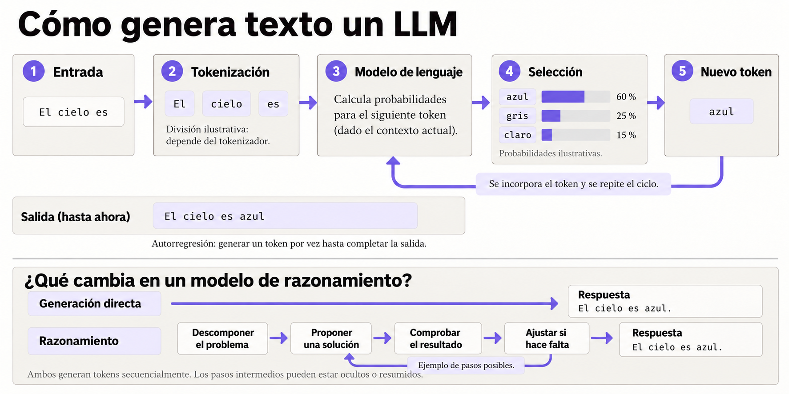

# Capítulo 2. Modelos de lenguaje a gran escala

## Grandes modelos de lenguaje

Un modelo de lenguaje, o LLM, genera texto a partir de la información que recibe. Primero divide la entrada en **tokens**, que pueden ser palabras, partes de palabras o signos. Después calcula qué token podría seguir y lo incorpora al texto.

El modelo repite este proceso hasta completar su salida. Este ciclo se llama **autorregresión** y permite generar desde una respuesta al usuario hasta una instrucción para usar una herramienta.

## Modelos de texto (text models) y modelos de razonamiento (reasoning models)

Una forma de mejorar un LLM es entrenarlo con más datos y recursos de cómputo. Otra es darle más tiempo de cómputo para elaborar una respuesta durante su ejecución. Esta segunda opción caracteriza a los modelos de razonamiento.

Un modelo de texto (text model) genera una respuesta directamente, token por token. Un modelo de razonamiento (reasoning model) dedica pasos intermedios a descomponer la tarea, evaluar alternativas y revisar posibles soluciones antes de responder. Esos pasos pueden quedar ocultos o mostrarse de forma resumida.

Ambos tipos generan tokens de manera secuencial. La diferencia está en el trabajo intermedio del modelo de razonamiento. Este proceso puede ayudar en tareas complejas, aunque suele requerir más tiempo y tokens, y no garantiza una respuesta correcta.

# Lo que debes saber sobre los modelos de lenguaje a gran escala

Los modelos de lenguaje son sistemas entrenados para predecir y generar secuencias de texto. Sus entradas y salidas se entienden mejor inicialmente como secuencias de palabras, o, más precisamente, tokens, que pueden ser palabras, partes de palabras, números o signos de puntuación.

## Tokens de entrada y salida

Antes de procesar el texto, el modelo lo divide en **tokens**. Cada token puede ser una palabra, parte de una palabra o un signo. Con esa secuencia como contexto, el modelo predice qué token podría seguir.

Para generar una respuesta, repite el proceso: agrega cada token nuevo al contexto y vuelve a predecir el siguiente. Así construye la salida token por token. Este ciclo se llama **generación autorregresiva**.

### Conversaciones de varios turnos

Cuando envías un mensaje en ChatGPT, la aplicación incluye la conversación relevante en la entrada del modelo. Así, puede relacionar tu pregunta con lo que ya se dijo y responder con continuidad.

El modelo no conserva por sí solo toda la conversación: usa el contexto que recibe en cada turno. En el capítulo 4 veremos cómo los agentes pueden gestionar ese contexto y usar memoria para conservar información útil.

## ¿Cómo se entrenan los LLM?

### Preentrenamiento (pre-training): modelado del lenguaje (language modeling)

El modelado del lenguaje consiste en presentar a un modelo una secuencia de palabras (o, más precisamente, tokens) y pedirle que prediga la siguiente palabra que tiene más probabilidades de aparecer. Esta fase requiere grandes cantidades de datos y consume la mayor parte del procesamiento computacional durante el proceso de entrenamiento.

Los datos de preentrenamiento se obtienen de fuentes como texto web, libros y código, filtradas según criterios de calidad. De ellas se extraen fragmentos que sirven como ejemplos de entrenamiento. Por ejemplo, podemos tomar un pasaje de un libro cuyo uso esté autorizado, ocultar el último token y pedirle al modelo que prediga cuál sigue a partir de los anteriores.

Al principio, el modelo suele equivocarse. Comparamos su predicción con el token correcto y calculamos la pérdida. Ese error sirve para ajustar los pesos y hacer más probable una predicción correcta la próxima vez. El proceso se repite miles de millones de veces hasta obtener un **modelo base**.

La mayoría de los modelos de lenguaje actuales se basa en la arquitectura Transformer. Su mecanismo de atención relaciona los tokens de una secuencia y permite procesarlos en paralelo durante el entrenamiento. Vaswani y sus colegas presentaron esta arquitectura en el artículo [“Attention Is All You Need” (2017)](https://arxiv.org/abs/1706.03762). GPT-3, publicado por OpenAI en 2020, fue uno de los modelos que mostró el potencial de escalar esta tecnología.

### Posentrenamiento (post-training)

El posentrenamiento adapta el modelo base para que siga instrucciones y responda de forma útil. Incluye técnicas como el ajuste fino supervisado y el aprendizaje por refuerzo.

### Ajuste fino supervisado (supervised fine-tuning, SFT)

Los modelos base pueden razonar, resumir, traducir y generar código, pero a menudo necesitan indicaciones complejas para activar esas capacidades. El ajuste fino supervisado los entrena con pares de solicitudes y respuestas para que sigan instrucciones. También se conoce como ajuste de instrucciones (instruction tuning).

En SFT, cada ejemplo reúne una solicitud y una respuesta esperada. La solicitud forma parte del contexto, pero sus tokens no se incluyen en el cálculo de la pérdida: el modelo aprende a generar la respuesta.

La fase de entrenamiento SFT es esencial, pero no suficiente para crear un modelo de vanguardia. Enseña al modelo a seguir instrucciones, pero no logra capturar por completo las preferencias humanas sobre qué hace que una respuesta sea realmente útil, precisa o bien fundamentada. El paso de aprendizaje por refuerzo que le sigue es el que impulsa al modelo en esa dirección.

### Aprendizaje por refuerzo (reinforcement learning, RL)

En SFT, el modelo aprende a partir de ejemplos de respuestas deseadas. El aprendizaje por refuerzo evalúa la calidad de las respuestas que genera y ajusta los pesos según una recompensa, sin requerir una respuesta de referencia para cada ejemplo.

### Aprendizaje por retroalimentación humana (reinforcement learning from human feedback, RLHF)

El aprendizaje por refuerzo a partir de la retroalimentación humana (RLHF) usa preferencias expresadas por personas. Un modelo de recompensa puede aprender esas preferencias y ayudar a evaluar nuevas respuestas.

Un único ejemplo de entrenamiento en un paso RLHF puede consistir en una indicación y dos opciones de finalización: una preferida y otra rechazada.

El objetivo del entrenamiento RLHF es actualizar el modelo para aumentar la probabilidad de generar una respuesta similar a la preferida y disminuir la probabilidad de generar una respuesta similar a la rechazada. Esto puede utilizarse para perfeccionar comportamientos del modelo como la longitud de la respuesta, el tipo de lenguaje que utiliza, los tipos de respuestas seguras que se deben generar o evitar, y muchos otros comportamientos.

### Aprendizaje por recompensas verificables (reinforcement learning from verifiable rewards, RLVR)

El aprendizaje por refuerzo con recompensas verificables actualiza el modelo con señales que pueden comprobarse automáticamente. Por ejemplo, un verificador puede comprobar si la respuesta sigue un formato o coincide con una solución conocida.

Más adelante veremos distintos tipos de verificadores y cómo se usan en RLVR.

### Optimización de políticas relativas de grupo (group relative policy optimization, GRPO)

GRPO ajusta el modelo comparando varias respuestas que generó para una misma pregunta. Cada respuesta recibe una recompensa, y el entrenamiento usa su puntuación relativa dentro del grupo para orientar el ajuste de los pesos.

Veamos un ejemplo. Tenemos problemas matemáticos con una solución conocida y queremos que el modelo escriba el resultado entre etiquetas, como `<answer>42</answer>`. Para cada problema, le pedimos varias respuestas y evaluamos dos cosas: si usó las etiquetas y si acertó el resultado.

Podemos asignar 0,3 puntos por respetar el formato y 0,7 por responder correctamente. Una respuesta correcta con las etiquetas obtiene 1 punto; una incorrecta con el formato pedido obtiene 0,3. Estos valores son una elección para el ejemplo, no una regla de GRPO.

Después comparamos las recompensas de las respuestas del grupo. Las que quedan por encima del promedio reciben una señal que favorece aumentar su probabilidad; las que quedan por debajo reciben la señal contraria. Así, el modelo aprende de las diferencias entre sus propias respuestas a una misma pregunta.

En este ejemplo, RLVR define cómo comprobar y recompensar las respuestas. GRPO usa esas recompensas para calcular el ajuste relativo dentro del grupo. En el capítulo 3 veremos cómo estas ideas se aplican al entrenamiento de modelos de razonamiento.

## ¿Qué LLM elegir para mi agente?

Para elegir un modelo para un agente, conviene mirar si puede razonar y usar herramientas, cuánto cuesta y dónde se ejecuta. Esta selección reúne opciones alojadas por API y una alternativa local. Los precios son dólares estadounidenses por millón de tokens de entrada y salida, consultados en noviembre de 2026.

| Modelo | Dónde se ejecuta | Cuándo considerarlo | Entrada / salida |
| --- | --- | --- | ---: |
| [GPT-6.1 Terra](https://developers.openai.com/api/docs/models/gpt-6.1-terra) | API | Opción rápida y eficiente que admite llamadas a funciones mediante la Responses API. | US$1 / US$5 |
| [Claude Sonnet 5.5](https://platform.claude.com/docs/en/models/sonnet-5-5/overview) | API | Equilibra velocidad y capacidad para tareas con herramientas; ofrece una ventana de contexto de 1 millón de tokens. | US$2 / US$10 |
| [Gemini 4 Argon](https://ai.google.dev/gemini-api/docs/models/gemini-4-argon) | API | Para tareas complejas y agentes de varios pasos; admite llamadas a funciones y contexto de 1 millón de tokens. El precio indicado rige hasta el 30 de noviembre de 2026. | US$2 / US$10; luego US$4 / US$20 |
| [Grok 4.7](https://docs.x.ai/developers/grok-4-7) | API | Incluye llamadas a herramientas y niveles configurables de razonamiento, con 500.000 tokens de contexto. | US$2 / US$6 |
| [DeepSeek V4.1 Flash](https://api-docs.deepseek.com/quick_start/pricing/) | API | Alternativa de bajo costo con llamadas a herramientas y contexto de 1 millón de tokens. La tarifa cambia según el horario. | Hasta US$0,30 / US$1,20 |
| [Gemma 4 12B](https://ai.google.dev/gemma/docs/core) | Local | Para ejecutar el modelo en tu propio equipo; admite llamadas a funciones. En cuantización Q4 requiere unos 6,7 GB para cargar los pesos, además de memoria para el contexto y el software. | Sin tarifa por token |

No hay un modelo que sea mejor para todos los agentes. Para comparar estas opciones, prueba las mismas tareas con cada una y mide si resuelven el objetivo, cómo usan las herramientas, cuánto tardan y cuánto cuestan. En los ejemplos de este capítulo usaremos Gemma 4 E4B, una variante más pequeña que permite ejecutar el agente localmente.

## ¿Qué esperamos del modelo?

Para empezar a construir nuestro agente, necesitamos definir cómo se va a comunicar con el modelo: qué información le enviamos y qué esperamos recibir.

El modelo recibe un contexto con las instrucciones y los mensajes relevantes para la tarea. Cuando incorporemos herramientas, ese contexto también incluirá los resultados de las acciones anteriores. En cada llamada, el modelo trabaja con la información que le pasamos.

Su salida puede ser una respuesta para el usuario o una solicitud para usar una herramienta. Nuestro código debe poder distinguirlas: una respuesta se puede entregar al usuario; una solicitud de herramienta necesita ser procesada antes de continuar.

El modelo puede elegir mal una herramienta, generar argumentos incorrectos o responder con información equivocada. Solicitar una acción tampoco significa ejecutarla. El código que rodea al modelo, al que llamamos **arnés del agente** (*agent harness*), se encarga de procesar esas solicitudes, ejecutar las herramientas disponibles y recoger sus resultados.

## Primera conexión con nuestro agente

Podemos empezar con una sola llamada al modelo: preparar los mensajes, enviar la solicitud y recoger la salida. Todavía no necesitamos el bucle completo del agente, pero sí una forma de representar lo que devuelve el modelo y registrar qué ocurrió.

Llamaremos **`Response`** a la salida del modelo. Este registro permite distinguir una respuesta final de una solicitud de herramienta. No incluye el resultado de una herramienta que todavía no se ejecutó.

Un **`Step`** representa un paso de la ejecución. Guarda la salida del modelo y, si se procesó una solicitud de herramienta, la observación que devolvió esa herramienta o el error que ocurrió. Conviene distinguir estos dos datos:

- **`answer`**: la respuesta final del modelo para el usuario.
- **`observation`**: el resultado que obtuvimos al ejecutar una herramienta.

La **`Trajectory`**, o trayectoria, reúne los pasos en orden. Al principio puede contener un único paso. Cuando agreguemos el bucle, permitirá seguir la secuencia de decisiones y resultados hasta la respuesta final.

Por ejemplo, ante la pregunta «¿Va a llover mañana en Santiago?», el modelo podría solicitar una consulta del pronóstico. El arnés ejecutaría esa consulta y registraría el resultado como observación. En una llamada posterior, el modelo recibiría ese resultado en el contexto y podría elaborar la respuesta para el usuario.

Ese historial nos permite investigar un error: comprobar qué pidió el modelo, qué devolvió la herramienta y qué respuesta se produjo después. Registra lo que ocurrió durante la ejecución; no revela los pensamientos internos del modelo.
